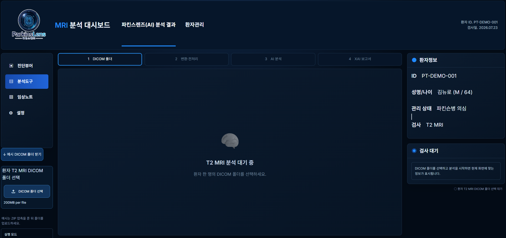
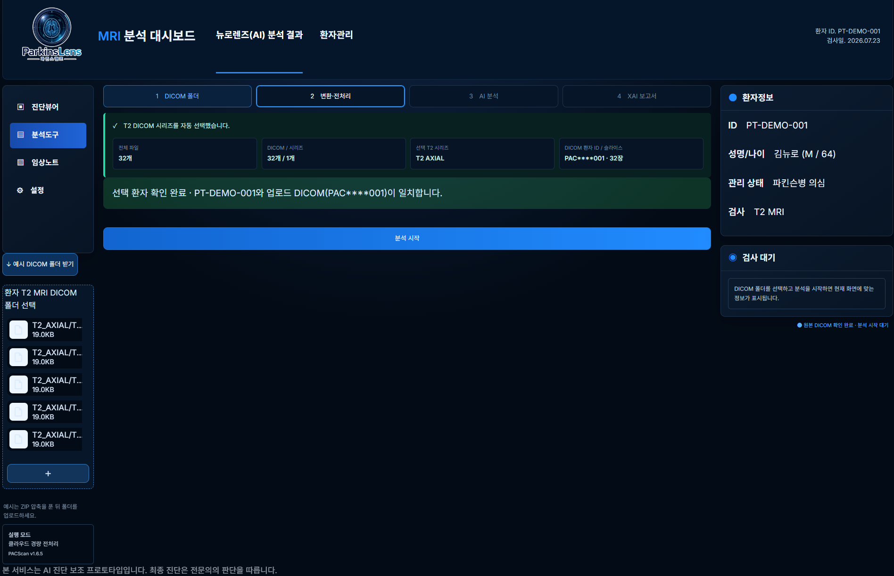
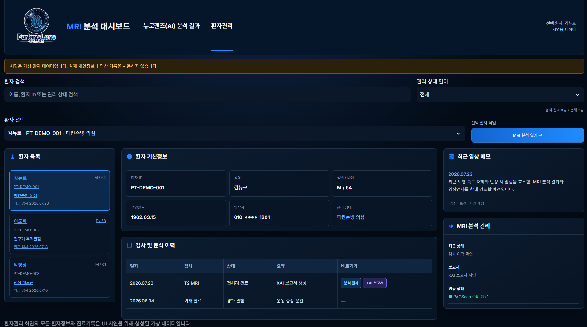
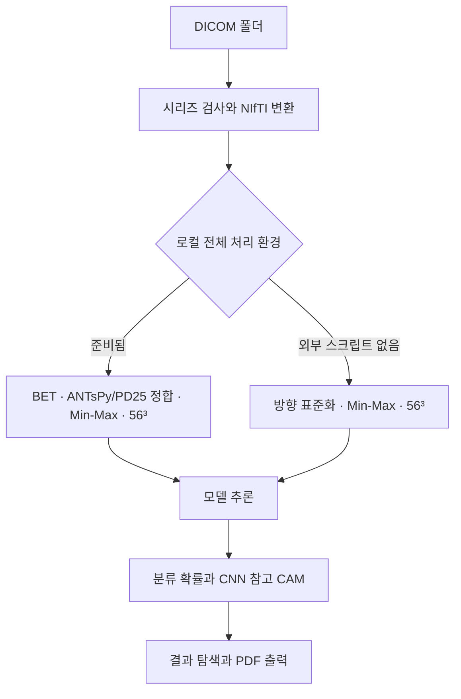

# ParkinsLens Web

**Streamlit 기반 뇌 MRI 전처리·AI 분류·설명 시각화 웹 프로토타입**

ParkinsLens 팀 프로젝트의 발표자료를 바탕으로 MRI 업로드부터 결과 확인과 PDF 보고서 출력까지 연결한 웹 구현입니다. 연구용 모델 코드와 사용자 화면을 분리해, 영상 처리 과정과 분석 결과를 한 화면에서 살펴볼 수 있도록 구성했습니다.

- 연구 프로젝트: [ParkinsLens](https://github.com/yd5170/ParkinsLens)
- 웹 구현: [ParkinsLens_web](https://github.com/yd5170/ParkinsLens_web)
- 실행 시작점: [`app.py`](app.py)

> 연구·학습 및 포트폴리오 시연용입니다. 임상 진단 성능을 검증한 제품이 아닙니다. 환자관리 화면은 가상 데이터이며, 클래스별 예측 확률과 템플릿 요약을 실제 임상 소견과 구분합니다.

## 프로젝트 배경

ParkinsLens는 T2 뇌 MRI에서 정상 대조군·전구기·파킨슨병의 3개 클래스를 구분하는 연구 프로젝트입니다. 발표자료는 영상 전처리 자동화, 3D-CNN·3D-ResNet 특징 추출, CCA 특징 융합, WOA 특징 선택과 결과 시각화를 제안합니다.

웹에서는 다음 사용 흐름을 구현했습니다.

1. 환자 한 명의 T2 MRI DICOM 폴더 업로드
2. DICOM 시리즈 검사·선택 및 3D NIfTI 변환
3. 실행 환경에 맞는 전처리 수행과 결과 확인
4. 모델 아티팩트가 준비된 경우 분류 추론과 CNN 분기의 CAM 표시
5. MRI 단면 탐색, 클래스별 예측 확률 확인 및 PDF 보고서 출력

논문의 성능 재현이나 병원 간 장비 편차 해소를 입증한 것은 아닙니다. 발표자료의 기획과 이 저장소의 실제 구현 범위는 [자료와 구현의 대응표](docs/source-notes.md)에 구분했습니다.

## 웹 화면

아래 이미지는 사용자가 제공한 `3팀(팍스캔)_파킨슨렌즈_수정본(2).pptx`의 32·33·35쪽에 포함된 기존 시연 화면입니다. 현재 수정본을 새로 실행해 촬영한 화면은 아니며, 표시 문구와 상태 처리에는 차이가 있습니다. 화면의 인물·검사 정보는 시연용입니다.

### DICOM 입력과 분석 대시보드



### 전처리 결과 확인



### 가상 환자 및 검사 이력



## 주요 기능과 구현 방법

| 기능 | 구현 방법 | 관련 파일 |
|---|---|---|
| DICOM 폴더 입력 | `pydicom`으로 헤더를 읽고 `SeriesInstanceUID`별로 분류. 시리즈 설명·프로토콜에서 T2 후보 선택 | `preprocessing_adapter.py` |
| 볼륨 변환 | `dicom2nifti`를 우선 사용해 DICOM 슬라이스를 NIfTI 볼륨으로 변환 | `preprocessing_adapter.py` |
| 경량 전처리 | 3D 형식 검사, RAS 방향 표준화, 비정상 수치 정리, 비영 voxel Min-Max 정규화, 56³ 선형 보간 | `preprocessing_adapter.py` |
| 전체 전처리 연결 | 외부 BRAINTENSOR의 v1 스크립트를 동적으로 불러와 FSL BET·ANTsPy/PD25 정합 등을 실행 | `local_pipeline.py` |
| 모델 추론 | 로컬 모델 연결을 우선 사용. 미준비 시 Hugging Face Hub 아티팩트 사용을 시도. CCA·WOA 아티팩트가 없거나 실패하면 CNN 단독 추론 시도 | `model_inference.py`, `cloud_model.py` |
| MRI 탐색 | 축상·관상·시상면 슬라이더, 상대 위치 연동, 확대·축소 및 초기화 | `app.py` |
| CAM 시각화 | CNN의 Grad-CAM을 시각화 배경에 리샘플링하고 ROI 내부 기여도를 표시 | `xai_rendering.py` |
| 환자·검사 전환 | 세션의 분석 컨텍스트를 분리하고 입력 파일의 내용 해시로 변경 감지 | `analysis_state.py` |
| 보고서 | 원본·시각화 이미지, 모델 확률과 클래스 기반 템플릿을 ReportLab PDF로 구성 | `pdf_report.py` |

이 저장소는 Streamlit 내부에서 Python 함수를 호출합니다. 별도 FastAPI/REST 백엔드, 영구 환자 DB, 로그인·권한 관리 및 RAG/LLM 보고서 생성은 구현되어 있지 않습니다. 화면의 임상노트·설정 등 일부 메뉴는 시연용 표시입니다.

## 전처리와 모델 구조



| 실행 모드 | 수행 범위 | 전제·한계 |
|---|---|---|
| 경량 모드 | DICOM 변환·방향 표준화·정규화·리사이즈 | BET·atlas 정합 없음. 모델 학습 전처리와 동등성이 검증되지 않은 실험용 경로 |
| 로컬 전체 모드 | 외부 v1 파이프라인을 통한 BET·PD25 정합·정규화·리사이즈 | 별도 연구 코드·FSL BET·ANTsPy·PD25 아틀라스 필요. 이 웹 구현의 v1 흐름은 N4 보정 제외 |
| 모델 미연결 | 전처리 결과와 명시적인 시연용 AI 화면 | 예시 확률·이미지를 실제 입력에 대한 추론 결과로 해석하지 않음 |

외부 전처리 스크립트는 있지만 실행 환경이 불완전하면 오류를 표시하고 중단합니다.

모델 결합 흐름은 **3D-CNN·3D-ResNet 특징 추출 → CCA 융합 → WOA 선택 마스크 → 최종 분류기**입니다. CCA와 WOA를 각각 별도의 신경망 모델로 계산한 '4개 신경망 앙상블'은 아닙니다. 웹은 이미 학습·저장된 아티팩트를 불러오며 학습이나 WOA 최적화를 새로 수행하지 않습니다.

**CAM은 CNN 분기의 참고 시각화**입니다. 최종 결합 분류기 전체의 설명이 아니며, 두 분기의 예측 클래스가 다를 수 있습니다. 해부학적 흑질 마스크가 없으면 추정 ROI를 사용합니다. 이 ROI와 색상은 병변 분할 또는 흑질 위축 측정 결과가 아닙니다. 자세한 설정은 [SN_MASK_SETUP.txt](SN_MASK_SETUP.txt)를 참고하세요.

## 기술과 데이터

| 구분 | 사용 내용 |
|---|---|
| 언어 | Python. 새 설치 환경은 Python 3.11 권장 |
| 웹·UI | Streamlit, CSS, Session State, Query Parameters |
| 영상 처리 | pydicom, dicom2nifti, nibabel, NumPy, SciPy, Pillow |
| 모델 | PyTorch, scikit-learn, joblib, Hugging Face Hub |
| PDF | ReportLab, Noto Sans KR |
| 전체 전처리용 외부 의존성 | BRAINTENSOR v1, FSL BET, ANTsPy, PD25 아틀라스 |
| 프로젝트 연구 데이터 | PPMI T2 MRI. 원본 연구 데이터와 평가 split은 이 웹 저장소에 포함하지 않음 |
| 공개 시연 데이터 | 합성 DICOM 32개, 합성 NIfTI, 가상 환자 3명 |

현재 외부 모델 아티팩트의 위치는 `cloud_model.py`의 `HF_REPO_ID`와 파일명 상수에 정의되어 있습니다. 외부 저장소의 접근 권한·파일·버전이 바뀌면 추론이 실패할 수 있습니다. 체크포인트와 joblib 파일은 신뢰할 수 있는 출처의 파일만 사용해야 합니다.

## 실행 방법

### 기본 실행

```bash
git clone https://github.com/yd5170/ParkinsLens_web.git
cd ParkinsLens_web
python -m venv .venv
```

Windows PowerShell:

```powershell
.\.venv\Scripts\Activate.ps1
python -m pip install -r requirements.txt
python -m streamlit run app.py
```

macOS/Linux:

```bash
source .venv/bin/activate
python -m pip install -r requirements.txt
python -m streamlit run app.py
```

1. 화면의 **예시 DICOM 폴더 받기**로 ZIP을 내려받습니다.
2. ZIP을 압축 해제한 뒤 **DICOM 폴더 선택**에서 폴더를 올립니다.
3. **분석 시작**을 누르고 전처리 결과·AI 분석·보고서 탭을 확인합니다.
4. 체크포인트 다운로드 실패 시 오류 안내와 시연용 화면을 확인할 수 있습니다. 첫 모델 다운로드에는 추가 시간과 메모리가 필요합니다.

### 로컬 전체 전처리

FSL BET, ANTsPy, PD25와 호환되는 연구 파이프라인을 먼저 준비합니다. 단순한 `pip install`만으로 FSL과 아틀라스가 설치되지는 않습니다.

```powershell
python -m pip install -r requirements-local.txt
$env:PACSCAN_BRAINTENSOR_SCRIPT = "C:\research\BRAINTENSOR\01_Preprocessing\스크립트\preparing_ref21order_v1.py"
$env:PACSCAN_PD25_ATLAS = "C:\research\templates\PD25-T1MPRAGE-template-1mm.nii.gz"
$env:PACSCAN_WSL_DISTRO = "Ubuntu-24.04"
python -m streamlit run app.py
```

`PACSCAN_BRAINTENSOR_CHECKPOINT`로 로컬 CNN 체크포인트를 지정할 수 있습니다. `PACSCAN_SN_MASK`는 시각화 배경과 같은 물리 좌표계의 이진 마스크를 지정합니다. 전체 전처리 산출물과 실행 기록은 `results/runs/`에 저장하며 공개 대상에서 제외합니다.

### Streamlit Community Cloud 설정

저장소 `yd5170/ParkinsLens_web`, 브랜치 `main`, 실행 파일 `app.py`를 선택합니다. 이는 배포 설정 안내이며, 실제 서비스 배포·운영이 완료되었다는 뜻은 아닙니다. Cloud는 경량 전처리를 사용하며 모델 크기와 실행 자원의 제약을 확인해야 합니다. 실제 환자 영상을 공개 시연 서비스에 업로드하지 마세요.

## 발표자료의 모델 결과

아래는 첨부 발표자료 19쪽의 **보고값**입니다. 이 저장소에서 다시 평가한 결과나 현재 연결된 체크포인트의 보장 성능이 아닙니다.

| 지표 | CCA Held-out Test | WOA 적용 최고 보고값 |
|---|---:|---:|
| Accuracy | 54.35% | 54.35% |
| Precision (macro) | 54.42% | 54.03% |
| Recall (macro) | 48.09% | 50.42% |
| F1 (macro) | 48.44% | 51.34% |

보고값 차이는 Recall +2.33%p, F1 +2.90%p, Precision −0.39%p입니다. 동일 분할·체크포인트·평가 조건은 추가 확인이 필요합니다. 이 수치를 웹 서비스 정확도나 임상 진단 성능으로 주장하지 않습니다.

## 검증과 개선

검증 실행 방법과 실제 확인 범위는 [검증 기록](docs/validation.md)에 정리했습니다. 회귀 검사는 다음 명령으로 실행합니다.

```bash
python -m unittest discover -s tests -v
```

웹 공개 준비 과정에서 환자·검사 간 이전 결과 잔존, 같은 입력의 중복 추론, 모델 아티팩트 확인 누락, 파일명·크기만 비교하던 입력 감지, 측정하지 않은 소견을 단정하던 요약 문구를 수정했습니다. 실제 모델 추론과 전체 의료영상 전처리의 재현 검증은 별도 연구 환경에서 필요합니다.

## 출처와 기여 범위

- 기획·화면 근거: PACScan 팀의 ParkinsLens 발표자료, `3팀(팍스캔)_파킨슨렌즈_수정본(2).pptx`.
- 원본 웹 코드: 사용자가 제공한 `PACScan-main(1).zip`. [PACScan](https://github.com/yjson0509maymay/PACScan), [BRAINTENSOR](https://github.com/yjson0509maymay/BRAINTENSOR) 연결과 동료 CCA 구현에 대한 기존 출처를 유지합니다.
- 연구 코드와 팀 프로젝트 전체 결과를 이 웹 저장소의 단독 개인 성과로 주장하지 않습니다. 개인 기여는 담당 기능과 실제 커밋 기록을 근거로 설명해야 합니다.
- 논문: *Bio-inspired feature selection for early diagnosis of Parkinson’s disease through optimization of deep 3D nested learning* 등 첨부 발표자료의 참고문헌을 프로젝트 배경으로 사용했습니다. 논문과 동일한 조건의 성능 재현은 확인하지 않았습니다.
- 이미지·로고는 제공 자료에 포함된 자산입니다. 제3자 자산의 재사용 권리와 원본 라이선스는 별도 확인이 필요하며, 이 저장소에 임의의 일괄 오픈소스 라이선스를 부여하지 않습니다.
