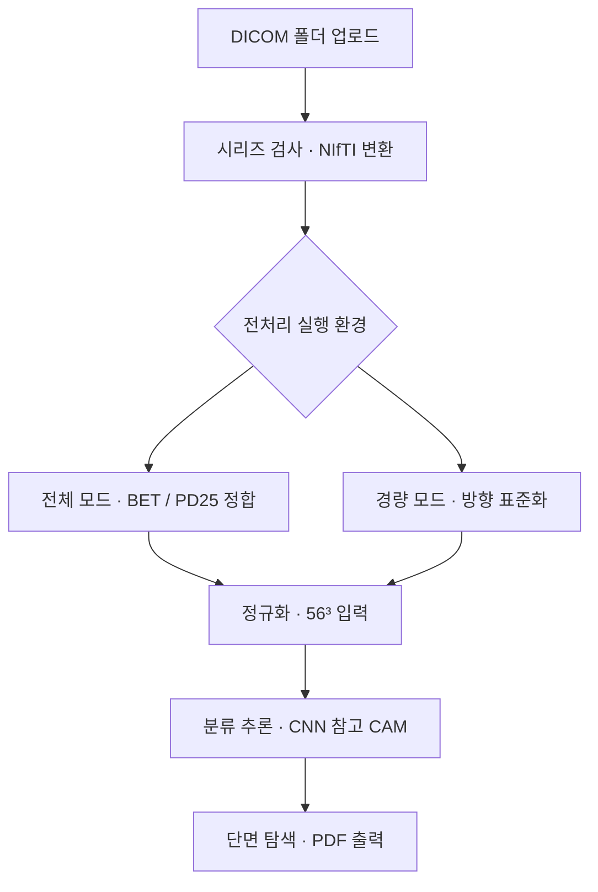

# ParkinsLens Web
### Streamlit 기반 뇌 MRI 전처리·AI 분류·결과 시각화 웹 프로토타입

**T2 MRI DICOM 업로드부터 전처리, 분류 결과 확인, MRI 단면 탐색과 PDF 보고서 출력까지 연결한 웹 프로젝트입니다.**

ParkinsLens의 모델 연구를 사용자가 확인할 수 있는 웹 화면으로 구현했습니다. 실행 환경에 따라 전처리 경로를 나누고, 환자·검사 전환 시 분석 상태를 분리해 화면에 반영하도록 구성했습니다.

[연구·모델 개발 저장소](https://github.com/yd5170/ParkinsLens) · [주요 기능](#3-주요-기능과-구현) · [실행 방법](#7-실행-방법)

---

## 1. 프로젝트 개요

| 구분 | 내용 |
|---|---|
| 문제 | 전처리·추론 코드를 개별 실행하면 입력 영상, 처리 과정, 분석 결과를 함께 확인하기 어려움 |
| 해결 방법 | DICOM 입력과 전처리·추론·시각화·보고서 출력을 하나의 웹 흐름으로 통합 |
| 사용자 흐름 | 영상 업로드 → 전처리 확인 → AI 결과 탐색 → PDF 출력 |
| 구현 방식 | Streamlit UI와 Python 영상 처리·모델 추론 모듈 연결 |
| 연구 모델 | 3D-CNN·3D-ResNet 특징 추출, CCA 융합, WOA 특징 선택 및 최종 분류기 |
| 화면 데이터 | 가상 환자·검사 이력과 합성 예시 영상 |

> 연구·학습 시연용 프로토타입입니다. 분류 확률과 참고 시각화는 임상 진단을 대신하지 않습니다.

## 2. 서비스 화면

아래 이미지는 프로젝트 발표자료에 포함된 시연 화면입니다. 현재 코드의 문구·상태 처리와 일부 차이가 있으며, 환자 정보는 시연용입니다.

### MRI 업로드와 분석 대시보드


### 전처리 결과 확인


### 가상 환자와 검사 이력


## 3. 주요 기능과 구현

| 기능 | 구현 방법 | 관련 코드 |
|---|---|---|
| DICOM 입력·시리즈 선택 | 헤더를 읽어 SeriesInstanceUID별로 묶고 T2 후보 시리즈 탐색 | [preprocessing_adapter.py](preprocessing_adapter.py) |
| 3D 볼륨 생성 | dicom2nifti 기반 DICOM → NIfTI 변환 | [preprocessing_adapter.py](preprocessing_adapter.py) |
| 전처리 모드 분리 | 외부 전체 파이프라인 연결 또는 경량 방향 표준화·정규화·리사이즈 | [local_pipeline.py](local_pipeline.py) |
| 모델 추론 연결 | 로컬 연결 우선, 외부 모델 아티팩트 로드 경로 제공 | [model_inference.py](model_inference.py), [cloud_model.py](cloud_model.py) |
| MRI 탐색 | 축상·관상·시상면 슬라이더와 확대·축소 | [app.py](app.py) |
| 참고 CAM 표시 | CNN Grad-CAM을 영상 배경에 맞춰 표시 | [xai_rendering.py](xai_rendering.py) |
| 분석 상태 관리 | 환자·검사별 컨텍스트와 입력 내용 해시로 결과 구분 | [analysis_state.py](analysis_state.py) |
| PDF 보고서 | 영상·시각화·예측 확률·클래스 기반 요약을 PDF로 구성 | [pdf_report.py](pdf_report.py) |

## 4. 전처리·추론 흐름



### 실행 환경에 따른 전처리

| 모드 | 처리 내용 | 준비 사항 |
|---|---|---|
| 경량 모드 | 3D 형식 검사, RAS 방향 표준화, 비정상 수치 정리, 비영 voxel Min-Max 정규화, 56³ 리사이즈 | 기본 requirements 설치 |
| 로컬 전체 모드 | 외부 v1 스크립트의 FSL BET·ANTsPy/PD25 정합·정규화·56³ 리사이즈 | 연구 스크립트, FSL, ANTsPy, PD25 아틀라스 |
| 모델 미연결 | 전처리 확인과 구분된 시연용 AI 화면 | 실제 추론 결과와 예시 화면을 구분 |

웹의 전체 모드는 `preparing_ref21order_v1.py`를 사용하며 **N4 보정은 포함하지 않습니다**. 경량 모드는 BET·atlas 정합을 수행하지 않으므로 학습 전처리와 동등한 경로로 검증된 것은 아닙니다.

### 모델 연결 방식

학습된 **CNN·ResNet 특징 → CCA 변환 → WOA 선택 마스크 → 최종 분류기**를 불러와 추론합니다. 필요한 결합 아티팩트가 없거나 결합 추론이 실패하면 CNN 단독 추론을 시도합니다.

웹에서 모델을 새로 학습하거나 WOA 최적화를 실행하지 않습니다. 모델별 성능과 실험 조건은 [ParkinsLens 실험 기록](https://github.com/yd5170/ParkinsLens/tree/main/03_Model_Training/results)에 정리되어 있습니다.

CAM은 **CNN 분기의 참고 시각화**이며 최종 결합 분류기 전체의 설명은 아닙니다. 해부학적 마스크가 없으면 추정 ROI를 사용합니다. [마스크 설정 안내](SN_MASK_SETUP.txt)

## 5. 구현 결과와 개선

| 구현 결과 | 내용 |
|---|---|
| 분석 흐름 통합 | 영상 입력부터 전처리·추론·시각화·PDF 출력까지 웹 화면으로 연결 |
| 실행 환경 대응 | 외부 전처리 도구가 필요한 전체 모드와 경량 모드를 분리 |
| 결과 상태 분리 | 환자·검사 변경 시 이전 분석 결과가 섞이지 않도록 컨텍스트 관리 |
| 입력 변경 감지 | 파일명·크기 비교에서 입력 내용 해시 기반 비교로 개선 |
| 중복 처리 개선 | 같은 분석 흐름에서 반복되던 추론 호출 정리 |
| 결과 표현 개선 | 측정하지 않은 임상 소견을 단정하는 대신 클래스 기반 템플릿 요약으로 구분 |

검증 기록은 [docs/validation.md](docs/validation.md)에 정리했습니다. 합성 입력을 통한 처리 흐름 검증과 실제 모델의 예측 성능 검증은 구분하며, 전체 의료영상 전처리와 실제 가중치 추론은 해당 연구 환경에서 추가 확인이 필요합니다.

## 6. 기술 스택과 데이터

| 구분 | 사용 내용 |
|---|---|
| Language | Python |
| Tool | GitHub, Hugging Face Hub, FSL BET·WSL(전체 모드) |
| Library · Web | Streamlit, Pillow |
| Library · Data / Imaging | NumPy, SciPy, pydicom, dicom2nifti, nibabel |
| Library · AI | PyTorch, scikit-learn, joblib |
| Library · Report | ReportLab, Noto Sans KR |
| 추가 의존성 | 전체 모드용 외부 BRAINTENSOR v1 스크립트, ANTsPy, PD25 |
| Data | 합성 DICOM 32개, 합성 NIfTI, 가상 환자 3명. 연구 배경 데이터는 PPMI T2 MRI |

이 앱은 Streamlit 내부의 Python 함수 호출 방식입니다. 환자·이력 화면은 세션 기반 시연이며, 영구 환자 DB·로그인·별도 REST 백엔드는 구현 범위에 포함하지 않습니다. 보고서는 LLM 생성이 아닌 템플릿 방식입니다.

## 7. 실행 방법

Python 3.11 환경을 권장합니다.

```bash
git clone https://github.com/yd5170/ParkinsLens_web.git
cd ParkinsLens_web
python -m venv .venv
```

**Windows PowerShell**

```powershell
.\.venv\Scripts\Activate.ps1
python -m pip install -r requirements.txt
python -m streamlit run app.py
```

**macOS / Linux**

```bash
source .venv/bin/activate
python -m pip install -r requirements.txt
python -m streamlit run app.py
```

1. 화면에서 **예시 DICOM 폴더 받기**를 선택합니다.
2. ZIP을 압축 해제한 뒤 DICOM 폴더를 업로드합니다.
3. **분석 시작** 후 전처리 결과·AI 분석·보고서를 확인합니다.
4. 모델을 처음 사용할 때는 외부 아티팩트 다운로드에 추가 시간과 메모리가 필요합니다.

### 로컬 전체 모드 설정

FSL BET·ANTsPy·PD25와 외부 연구 스크립트를 먼저 준비한 뒤 경로를 설정합니다.

```powershell
python -m pip install -r requirements-local.txt
$env:PACSCAN_BRAINTENSOR_SCRIPT = "C:\research\BRAINTENSOR\01_Preprocessing\스크립트\preparing_ref21order_v1.py"
$env:PACSCAN_PD25_ATLAS = "C:\research\templates\PD25-T1MPRAGE-template-1mm.nii.gz"
$env:PACSCAN_WSL_DISTRO = "Ubuntu-24.04"
python -m streamlit run app.py
```

로컬 CNN 가중치는 `PACSCAN_BRAINTENSOR_CHECKPOINT`, 시각화용 마스크는 `PACSCAN_SN_MASK`로 지정합니다. 전처리 실행 기록과 산출물은 `results/runs/`에 저장합니다.

### Streamlit Community Cloud

설정값은 저장소 `yd5170/ParkinsLens_web`, 브랜치 `main`, 실행 파일 `app.py`입니다. 이는 배포 방법 안내이며 실제 운영 완료를 의미하지 않습니다. Cloud에서는 경량 전처리와 모델 메모리 요구량을 확인해야 합니다.

## 8. 저장소 구성

| 경로 | 역할 |
|---|---|
| [app.py](app.py) | 웹 UI·페이지 이동·분석 실행 |
| [preprocessing_adapter.py](preprocessing_adapter.py) | DICOM 검사·변환·경량 전처리 |
| [local_pipeline.py](local_pipeline.py) | 외부 전체 전처리 연결 |
| [model_inference.py](model_inference.py) | 추론 연결과 결과 구성 |
| [cloud_model.py](cloud_model.py) | 외부 아티팩트 로드·CNN / 결합 추론 |
| [analysis_state.py](analysis_state.py) | 분석 컨텍스트·입력 변경 감지 |
| [xai_rendering.py](xai_rendering.py) | CAM·ROI 시각화 |
| [pdf_report.py](pdf_report.py) | PDF 생성 |
| [assets](assets) | 예시 영상·로고·한글 폰트 |
| [scripts](scripts) | 합성 예시 생성·실행 보조 |
| [docs](docs) | 화면 이미지·구현 대응표·검증 기록 |

## 9. 관련 자료

- [ParkinsLens 연구 저장소](https://github.com/yd5170/ParkinsLens): 데이터 전처리·모델 구현·실험 결과
- [발표자료와 코드 구현 대응표](docs/source-notes.md): 기획 내용과 실제 구현 범위
- [포트폴리오 설명 자료](docs/portfolio.md): 웹 기능과 구현 내용 정리
- [검증 기록](docs/validation.md): 확인한 범위와 추가 검증 항목

실제 환자 영상은 공개 시연 환경에 업로드하지 마세요. 원본 연구 데이터와 개인별 분석 산출물은 공개 저장소에 포함하지 않습니다.

